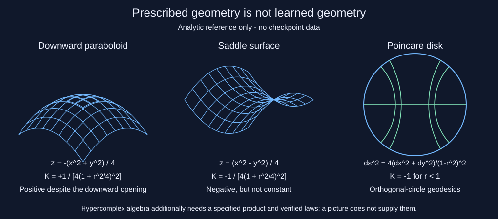

# IGBundle: Fiber-Structured Geometric Adapters for Language Models

**A research prototype exploring whether information-geometric operations and fiber-structured adapters can provide a useful inductive bias for language models.**

[](LICENSE)


> **Evidence status (30 October 2026):** The geometric inductive-bias idea remains an open research hypothesis, but the available experiments do **not** establish a general task-performance advantage, learned hyperbolicity, or training/inference efficiency gains. Previously advertised accuracy, “MFR,” ablation, and efficiency claims are retracted. Recorded-result arithmetic is reproducible offline; historical model runs and graders have not been independently reproduced. See the [correction notice](docs/correction-notice.md), [evidence ledger](docs/research_to_code_evidence_ledger.md), and [verification output](docs/benchmark-results/verification.json).

## Research design

IGBundle explores Poincare-ball coordinates, categorical fiber components, and geometric or dynamical operators as a possible structure for adapting language models. These describe the intended parameterization; they are not evidence that a trained model has learned semantic hierarchy, a fiber bundle, sheaf structure, or hyperbolic geometry.

In a historical experimental branch, a spatial log-determinant proxy cancels a position-independent metric factor at **fixed coordinates**. That is not a measurement of learned curvature. Coordinates may change with training, and the actual metric need not be flat. This historical proxy is not the current public branch's default adapter. Operator checks, geometry diagnostics, and downstream task evaluation answer different questions.

## What the evidence currently shows

### October 2026 local multi-benchmark evaluation

A 27 October local run compared an exported Qwen2.5-7B checkpoint (cp300), the base model, and a reconstructed composite with runtime IGBundle adapters. It used greedy decoding on fixed, small subsets (8–98 examples per task). Its “intelligence index” is a custom weighted average, not a standardized benchmark:

| Variant | Custom weighted index | Scope |
|:---|---:|:---|
| Base Qwen2.5-7B | 61.1 | Q4_K_M GGUF |
| Merged cp300 checkpoint | 60.0 | Q4_K_M GGUF |
| Reconstructed adapter composite | 64.7 | Separate NF4/bf16 loading path |

No individual paired task comparison was statistically significant. The reconstructed composite had higher point estimates than cp300 on 5/6 tasks, but every recomputed exact McNemar p-value was at least 0.625 (0.63 in the rounded historical table). These small subsets cannot establish equivalence or a broad benefit.

**Checkpoint caveat:** the exported cp300 weights did not contain the runtime geometric adapter. The reconstructed arm grafted a surviving adapter trained on the base model onto cp300; it was not the original trained checkpoint. Model assembly and quantization also differed. This exploratory, post-hoc reconstruction does not isolate a geometric effect. The [per-task summary](docs/benchmark-results/aa-index-2026-10-27.csv) includes sample counts, scores, weights, parse failures, and paired p-values.

The [252 paired recorded grades](docs/benchmark-results/aa-paired-outcomes-2026-10-27.csv) now permit recomputing accuracies, custom indices, and exact two-sided McNemar tests. These are recorded grader decisions, not newly verified answers. Source hashes and missing provenance are disclosed in the [provenance manifest](docs/benchmark-results/provenance.json). Nonsignificance does not demonstrate equivalence or “no harm.”

| Task | n | Base | Merged cp300 | Reconstructed composite | McNemar p, composite vs cp300 |
|:---|---:|---:|---:|---:|---:|
| MMLU-Pro | 98 | 53.1% | 48.0% | 51.0% | 0.68 |
| ARC-Challenge | 60 | 90.0% | 88.3% | 91.7% | 0.69 |
| MATH-500 | 40 | 40.0% | 45.0% | 50.0% | 0.73 |
| GSM8K | 30 | 83.3% | 76.7% | 80.0% | 1.00 |
| IFBench-lite | 16 | 68.8% | 68.8% | 81.2% | 0.63 |
| Degeneration probes | 8 | 75.0% | 75.0% | 75.0% | 1.00 |

### September 2026 paired token-NLL probe

On 24 examples reported as held out, with 64 tokens scored per example, mean token negative log-likelihood was 2.3188 for the frozen base, 1.9352 for geometric adapter A, and 0.8187 for vanilla-LoRA control B. B had lower NLL on all 24 examples. The mean paired difference `A − B` was +1.1165 (95% paired t interval `[0.9144, 1.3186]`). The independently recomputable two-sided sign-test p-value is `1.1921 × 10⁻⁷`; it is not the historical paired t-test p-value.

This is a small language-modeling probe, not task accuracy. A had 4,160,713 trainable parameters and one geometric layer; B had 585,728 parameters and 13 LoRA layers. The comparison does not isolate geometry, layer coverage, or objective. [Per-example scores](docs/benchmark-results/matched-token-nll-2026-09-20.csv) are published without prompt text.

### Historical diagnostics and task evaluations

- The historical audit file reports **6/6 checks passed**, but does not bind the run to immutable source and checkpoint hashes. The inspected audit loader allows random initialization when weights are missing and non-strict loading. Its displacement and squared-coordinate-norm proxies do not verify parallel transport or Hamiltonian energy conservation. Retained as a historical report, **not operator certification**. [Audit data](docs/benchmark-results/faithfulness-audit-A.json) · [method limitations](docs/benchmark-results/provenance.json).
- Historical zero-shot ARC-Challenge `acc_norm` was **54.86% for both** an adapter checkpoint and the base (1,172 test items per run). This is a separate protocol and dataset size from the October subset run. [Adapter results](docs/benchmark-results/arc-challenge-adapter-2026-01.json) · [Base results](docs/benchmark-results/arc-challenge-base-2026-01.json).
- A separate historical ARC-AGI evaluator reported **1/100 (1%)**, but scored only the first test pair per task and allowed substring matching. This is not an all-test-pair exact-task solve rate. Model-First Reasoning format compliance was **0/100**; it is a prompt-format metric, not geometric faithfulness. [Historical aggregate](docs/benchmark-results/arc-agi-summary.json) · [strict rescoring of the saved first-pair answers](docs/benchmark-results/arc-agi-rescore.json).

The new last-grid-candidate parser scores those saved first-pair outputs **0/100**. The previously accepted answer contains the correct grid followed by a code-array expression, which the new policy rejects. This is a **parser-policy sensitivity result**, not new inference or proof that the model never emitted a correct answer. The repaired scorer is a declared local protocol, not an official ARC leaderboard evaluator.

The historical value near -5.63 is not evidence of learned hyperbolicity. For `g(x) = lambda(x) G`, `log det g = D log lambda + log det G`; spatial differences remove the second term when G is position-independent. This limited algebraic statement does not certify the other claims in the historical [falsification draft, section 2.6](https://github.com/jesusvilela/IGBundle-LLM/blob/579dd7c2220abc146bf7380afb55f188f6f461b1/draft_paper_falsification.md).

## Verified implementation boundary

| Surface | What is checked | What is not established |
|---|---|---|
| Default-adapter restoration | Exact registered tensor coverage, shapes, finite values and safe dtype conversion before copying; missing-weight rejection in five HF entry points; tiny restored-operator execution | Historical checkpoint compatibility, base/LoRA identity, production HF loading, or GGUF adapter execution |
| Default `IGBundleAdapter` / Poincare affinity | Radial projection, analytic origin distances, exact zero diagonal, symmetry, sampled triangle inequalities, finite/checked gradients, float32/bfloat16 small-tensor forward/backward, identity initialization | Trained-model quality, learned geometry, or all possible numerical inputs |
| `arc_eval.py`, HF and GGUF ARC runners | Shared deterministic selection, strict grid equality, all test pairs, errors retained and run invalidated, explicit empty-run rejection, output overwrite protection | Backend model loading or restoration of separate runtime adapter weights; no new model evaluation was run |
| Historical evidence | Recomputed NLL means and paired statistics; October accuracies, indices and McNemar tests; source hashes and first-pair ARC rescoring | Independent grading, dataset non-contamination, or complete reproduction from a fresh clone |
| Legacy `geometry/riemannian.py`, `GeometricIGBundleAdapter`, training and experimental geometry modules | **Outside the validated core** | The metric is position-independent while connection coefficients come from an unrelated network; these do not establish Levi-Civita geometry, categorical laws, or sheaf laws. The legacy `train.py` entry point also contains an incomplete trainer block and is not a supported training command. |

The Poincare affinity correction changes historical numerics; old checkpoint scores must not be attributed to the corrected implementation without reevaluation. The default adapter is now exactly residual-identity at initialization (both output weights and bias are zero). No new checkpoint or performance result is implied.

## Expanded archive audit: GGUFs and images

Two surviving model GGUFs were inspected without reading tensor payloads: the cp600-named Q8_0 export contains **339 ordinary Qwen2 tensors**; the 0.5B F16 export contains **290**. Their packaged fast path does not load the separate geometric adapter. These files are distinct from the October cp300 benchmark artifacts. Prefix fingerprints identify the inspected headers, **not the full checkpoints**.

Nine research images were reviewed against their generators. The thesis loss, affinity and spectrum plots are synthetic and now labeled inside the public PNGs. An archived “negative curvature” drawing actually depicts a positive-curvature paraboloid; prescribed layouts and simulated convergence curves are not learned-geometry results.



**Hyperbolic geometry is not hypercomplex algebra.** A verified Poincare operator, a high-dimensional vector, or a Hamiltonian module does not establish a quaternion/octonion product or its execution in a GGUF. No such integration is established by the inspected paths. The geometric approach remains a hypothesis, not a claim rescued by relabeling diagrams.

[Full export/image audit and derivations](docs/export-image-audit.md) · [GGUF cp600-named directory](docs/benchmark-results/gguf-dist-directory.json) · [GGUF 0.5B directory](docs/benchmark-results/gguf-arc-directory.json) · [Image/source fingerprints and excerpts](docs/benchmark-results/artifact-audit.json).

## Project structure

```
src/igbundle/
├── geometry/          # Legacy experimental geometry; not certified
├── modules/           # Default mixture adapter, KL, affinity, and losses
├── integrations/      # Hugging Face block wrapping
└── training/          # Legacy experimental training utilities

tests/                 # Unit and integration tests
configs/               # Research configurations
docs/                  # GitHub Pages and evidence summaries
```

## Getting the code

```bash
git clone https://github.com/jesusvilela/IGBundle-LLM.git
cd IGBundle-LLM
```

This repository is experimental code, not a supported inference product. Existing hosted checkpoints are historical artifacts; verify their source/configuration compatibility and model-license terms before use. No model download, training run, or hardware requirement is implied by cloning this repository.

### Low-resource verification

With any Python 3.10+ interpreter, no third-party packages are needed for:

```bash
python scripts/verify_evidence.py
python -m unittest discover -s tests -p test_evidence.py
python -m unittest discover -s tests -p test_arc_eval.py
python -m unittest discover -s tests -p test_gguf_inspection.py
python -m unittest discover -s tests -p test_artifact_audit.py
```

In an existing environment with PyTorch, the bounded operator checks are:

```bash
python -m unittest discover -s tests -p test_geometry.py
python -m unittest discover -s tests -p test_ig.py
python -m unittest discover -b -s tests -p test_checkpoint.py
```

Use `CUDA_VISIBLE_DEVICES=""`, `OMP_NUM_THREADS=1`, `MKL_NUM_THREADS=1`, and `OPENBLAS_NUM_THREADS=1` to bound local resources. None of these commands loads a model, downloads data, or runs LLM training. Do not use blanket test discovery as a lightweight check: the legacy `test_pipeline.py` invokes the unsupported model-training entry point.

The [CPU evidence workflow](.github/workflows/evidence.yml) runs only this bounded suite. Its green result means these contracts passed, not that the whole experimental repository or its scientific claims are certified.

### Fail-closed adapter restoration

`app.py`, `benchmark.py`, `bench_arena.py`, and `validate_effects.py` now require
`adapter_weights.pt` when an adapter checkpoint is requested; `evaluate.py`
requires `full_state_dict.pt`. Missing or incompatible state no longer silently
leaves random default adapters active. The shared loader uses CPU,
`weights_only=True`, and exact registered names; it does not guess key prefixes.
Declared PEFT load errors propagate instead of becoming warnings.

This is an intentional compatibility break for partial checkpoints. It is not
a converter for the archived `adapter_refined.pt` or `arc_adapter.pt`, and does
not repair the separate GGUF runner. Full-state mode restores only default
adapter tensors, not the base or LoRA. See the
[restoration contract and limits](docs/export-image-audit.md#default-adapter-restoration-checkpoint).

### Demo evidence boundaries

The experimental `app.py` no longer substitutes synthetic training curves,
hard-coded ablation bars, or invented statistics when evidence is unavailable.
Those panels explicitly show missing evidence. The withdrawn performance and
efficiency claims have been removed from the demo itself.

Live sigma values are **Gaussian standard deviations, not curvature**.
The categorical heatmap shows probabilities, not pairwise affinities. Entropy is
descriptive, and the old sigma interval counter is no longer called “MFR” or
graded as geometric quality. Missing telemetry is unavailable, not zero.
Accumulation supports varying decode lengths and retains at most 4,096 sigma
samples plus fixed-size summaries; the histogram is explicitly a prefix sample.

Plotting checks use tiny arrays, not an LLM:

```bash
python -m unittest discover -b -s tests -p test_demo_evidence.py
```

They require NumPy, Matplotlib, Pillow and Gradio; the hosted workflow runs them headlessly.
`requirements-demo.txt` lists optional UI dependencies in addition to the base
requirements. The launcher now requires an explicit `--checkpoint` path.
The UI is constructed with a stubbed model and intercepted server launch.
These checks do **not** validate a running server or real model/backend loading.
See the [demo correction scope](docs/export-image-audit.md#demo-evidence-checkpoint).

## Research standard

The hypothesis remains open. A stronger causal test should match parameter budget and layer placement, isolate the geometric operator/objective, use a shared split and training budget with multiple seeds, and publish exact checkpoint provenance and task-level outputs. Geometry diagnostics alone cannot establish language-model benefit.

## Citation

```bibtex
@misc{vilela2025igbundle,
    title   = {IGBundle: Fiber-Structured Geometric Adapters for Language Models},
    author  = {Vilela Jato, Jes{\'u}s},
    year    = {2025},
    url     = {https://github.com/jesusvilela/IGBundle-LLM}
}
```

## License

All rights reserved. See [LICENSE](LICENSE).

*© 2025–2026 Jesús Vilela Jato*
