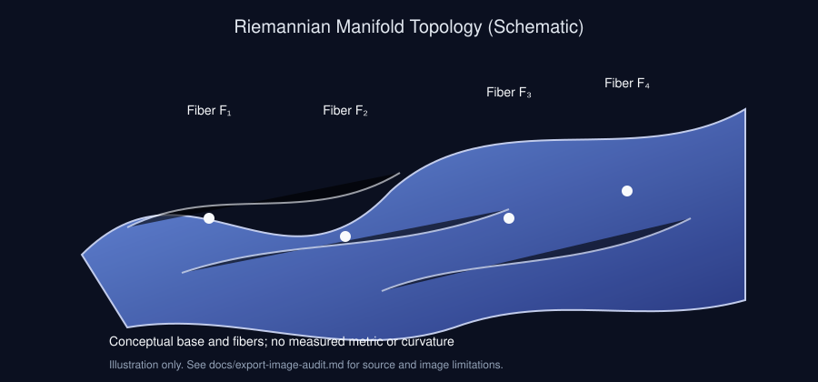
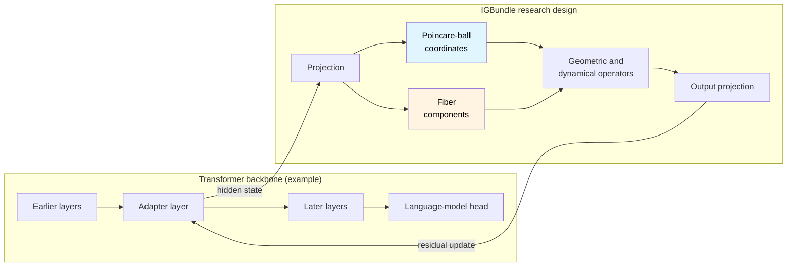

# IGBundle: Fiber Bundle Adapters for Language Models

**Research prototype exploring information-geometric and fiber-structured adapters for language models.**

[](LICENSE)


[](draft_paper_falsification.md)

> **Research status:** IGBundle is experimental. The geometric inductive-bias idea remains a testable hypothesis, but current evidence does **not** establish a downstream task-performance advantage, learned hyperbolicity, or training/inference efficiency gains. See [the evidence ledger](docs/research_to_code_evidence_ledger.md), the [October 2026 evaluation summary](docs/benchmark-results/aa-index-2026-10-27.csv), and the [September paired-probe data](docs/benchmark-results/matched-token-nll-2026-09-20.csv).

<div align="center">



*Conceptual fiber-bundle illustration; it is not a measurement of learned semantic structure.*

</div>

---

## What is IGBundle?

IGBundle is a research codebase for testing whether information-geometric operations and fiber-structured representations can provide a useful inductive bias when adapting language models. The fiber-bundle and hyperbolic-space language describes the intended mathematical design; it is not evidence that a trained model has learned semantic hierarchy or that the design improves reasoning.

The historical geometric arm evaluated in the paired probe used a single transformer layer. Its design includes:

- **Poincare-ball coordinates** — a hyperbolic representation space used by the geometric operators
- **Categorical fiber sections** — structured components intended to represent alternative local states
- **Riemannian and dynamical operators** — candidate geometric constraints and state updates

## Architecture



This is a conceptual view of the research design, not a guarantee of preserved behavior or a validated deployment architecture.

## Mathematical Foundation

**Fiber-bundle hypothesis.** The design uses a Poincare-ball base and categorical fiber components as a structured parameterization. Its use does not by itself establish that transformer representations form a learned fiber bundle.

**Curvature telemetry.** The default conformal factor is fixed, so the historical curvature readout is weight-invariant and cannot show that training learned hyperbolic geometry. The default curvature regularizer therefore cannot bind to a trainable conformal parameter. See `draft_paper_falsification.md` §2.5–§2.6 and `config.learnable_conformal`.

**Consistency and dynamics.** The code includes local consistency and dynamical terms. These are implementation-level operators or neural surrogates, not verified sheaf laws or evidence of global semantic coherence.

## Evidence

### Operator diagnostics

The March 2026 faithfulness audit reports six passing checks on the evaluated operators. These are local diagnostics, not model-quality or learned-geometry results.

| Metric | Value | Interpretation |
|:---|:---:|:---|
| Curvature readout | -5.630 ± 0.131 | Fixed-conformal architecture diagnostic; not learned curvature |
| Fiber entropy | 0.952 ± 0.014 | Distribution statistic; does not establish useful specialization |
| Jensen-Shannon divergence | 0.424 | Distribution difference; does not establish semantic coherence |
| Transport displacement ratio | 0.0406 | Transport diagnostic; not a holonomy measurement |
| Geodesic triangle checks | 0 / 2,970 violations | Reported checks for the tested configurations |
| Maximum energy drift | 3.47 × 10⁻⁶% | Reported integration diagnostic |
| Faithfulness checks | **6 / 6 passed** | Scope is the tested operators/configuration only |

Source: [`A_faithfulness_audit.json`](experiments/falsification/results/A_faithfulness_audit.json). The curvature caveat is derived in `draft_paper_falsification.md` §2.6.

### Task and language-modeling evidence

#### October 2026 local multi-benchmark evaluation

A 27 October local run compared an exported Qwen2.5-7B checkpoint (cp300), the base model, and a reconstructed composite with runtime IGBundle adapters. It used fixed, small subsets (8–98 examples per benchmark), greedy decoding, and a custom weighted index:

| Variant | Custom weighted index | What was evaluated |
|:---|:---:|:---|
| Base Qwen2.5-7B | 61.1 | Q4_K_M GGUF |
| Merged cp300 checkpoint | 60.0 | Q4_K_M GGUF; no runtime geometric adapter in the exported weights |
| Reconstructed adapter composite | 64.7 | Runtime adapters grafted onto cp300; separate NF4/bf16 loading path |

No individual paired benchmark difference was statistically significant. The reconstructed composite had higher point estimates than cp300 on 5/6 tasks, but every reported McNemar p-value was at least 0.63. The weighted index is a custom summary, not a standardized benchmark or a significance test. Its subset sizes are too small to support a broad efficacy claim.

**Important artifact caveat:** the exported cp300 checkpoint evaluated in this run did not contain the geometric adapter. The “reconstructed” arm attached a surviving adapter trained on the base model to cp300; it is not the original trained checkpoint. Quantization and model assembly also differed between the reconstructed arm and the GGUF arms. This run therefore does not isolate a geometric effect and is exploratory, not a confirmation of benefit. The [per-benchmark summary](docs/benchmark-results/aa-index-2026-10-27.csv) records scores, sample sizes, weights, and paired p-values.

#### September 2026 paired token-NLL probe

This separate probe compared one geometric checkpoint (A) with one vanilla-LoRA control (B) on 24 held-out examples, each scored over 64 tokens:

| Arm | Mean token NLL |
|:---|:---:|:---|
| Bare frozen base | 2.3188 |
| Geometric adapter A | 1.9352 |
| Vanilla-LoRA control B | **0.8187** |

B had lower NLL on all 24 paired examples. The mean paired difference `A − B` was **+1.1165 NLL** (95% paired t interval `[0.9144, 1.3186]`; `t = 11.4275`, two-sided `p = 5.83 × 10⁻¹¹`). The [paired rows](docs/benchmark-results/matched-token-nll-2026-09-20.csv) make the probe scores inspectable.

**Limitations:** this is a small token-NLL probe, not task accuracy. The arms were not parameter matched: A had 4,160,713 trainable parameters and B had 585,728; A used one geometric layer while B used 13 LoRA layers. The result does not isolate geometry, architecture, layer coverage, or objective, and it does not establish that the geometric approach is generally ineffective.

Two historical task evaluations do not support a performance-gain claim:

| Evaluation | Geometric checkpoint | Base | Protocol / scope |
|:---|:---:|:---:|:---|
| ARC-Challenge `acc_norm` | 54.86% | 54.86% | Zero-shot; 1,172 items per run; January 2026, distinct from the October subset protocol; [adapter results](eval_results_opt_merged/output__igbundle_qwen7b_riemannian_merged/results_2026-01-12T08-03-35.296455.json), [base results](eval_results_baseline/unsloth__Qwen2.5-7B-Instruct/results_2026-01-11T12-52-17.625356.json) |
| ARC-AGI exact solve | 1 / 100 (1%) | — | Historical run; 95% Wilson interval `[0.18%, 5.45%]`; [raw evaluation](arc_evaluation_results.json) |
| ARC-AGI Model-First Reasoning compliance | 0 / 100 (0%) | — | Prompt-format compliance, not geometric faithfulness |

The historical ARC-Challenge score is equal to the base at the reported precision, not an improvement. It is not directly comparable to the later small-subset ARC run. The ARC-AGI run is low-performing and has no matched base comparison. None of these artifacts establishes current-checkpoint task quality. Older TruthfulQA, Winogrande, GSM8K, efficiency, and “+131.5%” claims are not presented as evidence of benefit because the repository does not establish suitable matched comparisons for them.

## Project Structure

```
src/igbundle/
├── geometry/          # Riemannian, hyperbolic, Poincare, KAN manifold
├── modules/           # Geometric adapter, losses, attention, vision
├── dynamics/          # Hamiltonian, FitzHugh-Nagumo, equilibrium propagation
├── fibers/            # Fiber state, constraints, swarm executor
├── steering/          # GSP controller (inference-time feedback)
├── optimization/      # Symplectic optimizer, SPIDER variance reduction
├── training/          # Geometric trainer, GRPO, losses
├── quantum/           # Gibbs sampling, scrambling
└── nn/                # KAN (Kolmogorov-Arnold Networks)

thesis/                # Academic thesis (PDF + LaTeX sources)
tests/                 # Geometry, pipeline, and integration tests
configs/               # Training and ablation configurations
assets/                # Visualizations and figures
```

## Quick Start

### Installation

```bash
git clone https://github.com/jesusvilela/IGBundle-LLM.git
cd IGBundle-LLM
pip install -r requirements.txt
```

There is no validated, supported model-release or one-command inference claim in this README. Treat existing hosted checkpoints as historical research artifacts and verify their source/configuration compatibility before use.

### Training

```bash
python train.py --config configs/qwen25_7b_igbundle_riemannian.yaml
```

### Evaluation

```bash
python eval_arc.py --checkpoint <path> --limit 100 --mfr
```

## Active Development

The research question remains open beyond the specific probes above. A stronger test should match parameter budget and layer placement, isolate the geometric operator/objective, and report repeated runs with the raw task-level results.

## Related Work

This project builds on ideas from:

- Nickel & Kiela (2017) — Poincare Embeddings for Hierarchical Representations
- Turner et al. (2023) — Activation Addition: Steering Without Optimization
- Grmela & Ottinger (1997) — GENERIC framework for non-equilibrium thermodynamics
- Chen et al. (2022) — Fully Hyperbolic Neural Networks
- McClelland et al. (1995) — Complementary Learning Systems

## Citation

```bibtex
@misc{vilela2025igbundle,
    title   = {IGBundle: Fiber Bundle Adapters for Language Models},
    author  = {Vilela Jato, Jes{\'u}s},
    year    = {2025},
    url     = {https://github.com/jesusvilela/IGBundle-LLM}
}
```

## License

All rights reserved. See [LICENSE](LICENSE) for details.

---

*IGBundle is an active research project. The reported measurements are bounded to their stated artifacts and protocols; no general performance advantage is claimed.*
*(c) 2025-2026 Jesus Vilela Jato*
